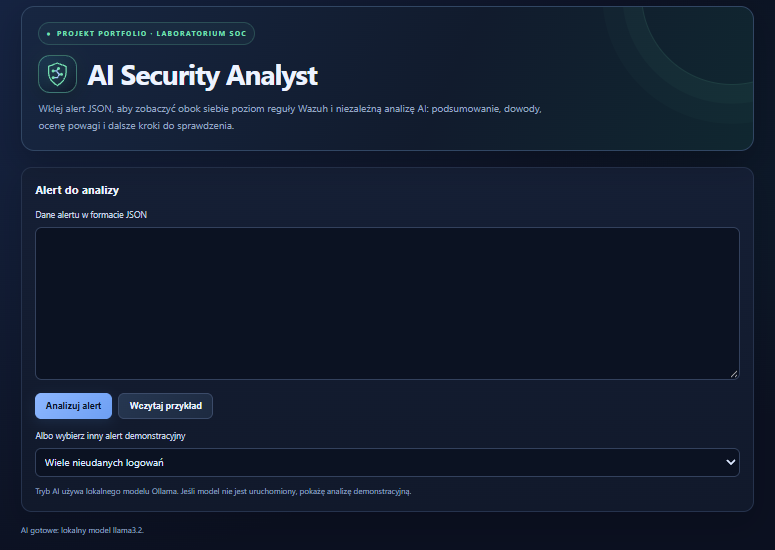
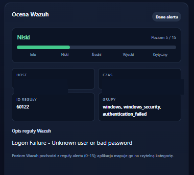
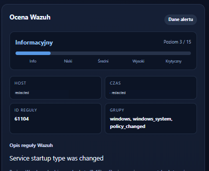
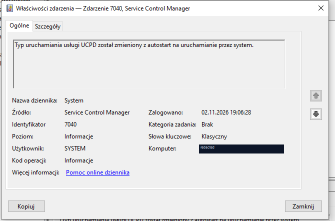
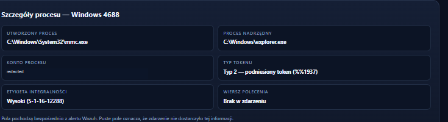
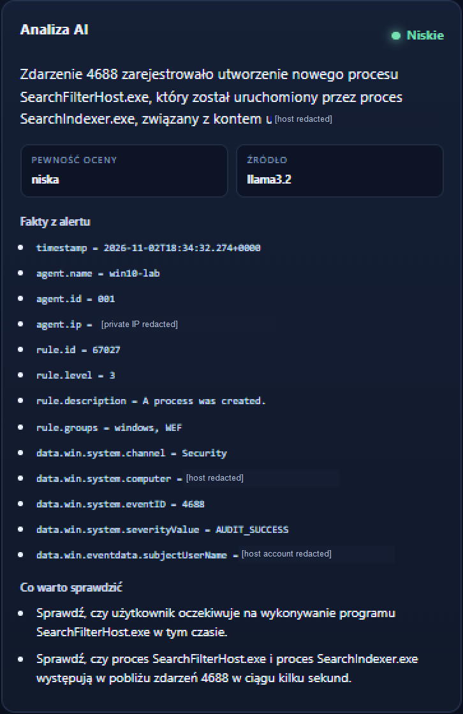
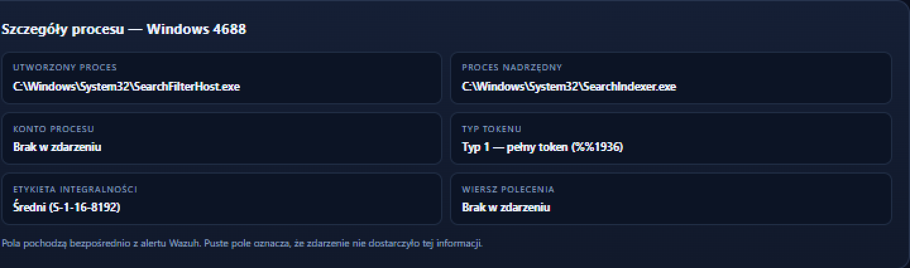

# Wazuh AI Alert Triage Lab

A hands-on SOC lab for collecting Windows security events with Wazuh and comparing Wazuh rule severity with a local AI analyst powered by Ollama. The project explores how an LLM can help explain alerts, where its interpretation can be wrong, and how selected claims can be checked against the original event fields. This lab demonstrates my practical use of Wazuh and a local LLM (Ollama) to triage Windows security alerts, validate AI-generated claims against event evidence, and keep a human analyst in the loop.

## Lab Architecture

- **Wazuh Manager 4.14.9** — deployed from the official virtual appliance in VirtualBox.
- **Windows 10 endpoint** — isolated lab VM monitored by the Wazuh agent.
- **VirtualBox Host-Only network** — connects the two lab VMs for management and telemetry.
- **Ollama with Llama 3.2** — local model used for alert summaries and triage suggestions.
- **AI Security Analyst app** — HTML/CSS/JavaScript frontend with a small PowerShell HTTP backend, running on `127.0.0.1:8000`.
- **Alert transfer** — copy a Wazuh alert as JSON and submit it to the local app; live Wazuh API integration is not implemented.
- The app presents Wazuh's numeric rule level with its own display categories; the original Wazuh level remains visible as the source value.

## Application Preview



*The main screen shows the alert input, demonstration scenario selector, and local Ollama status.*

## Current Detection Scenarios

### INC-001 — Failed Local Logon

A controlled failed interactive logon generated Windows Security Event ID `4625` and Wazuh rule `60122` (level 5).

The event identified a failed local logon; it did not, by itself, establish remote access or malicious activity. The AI wording was reviewed against the original event before drawing conclusions.

**Status:** Collected and reviewed in Wazuh and the local app.



*Wazuh classifies the failed logon at level 5. Host and timestamp values are redacted in this screenshot.*

### INC-002 — Windows Service Start-Type Change

Windows System Event ID `7040` recorded the `UCPD` service start type changing from automatic start to system start. Wazuh rule `61104` assigned level 3.

The event ran in the `SYSTEM` security context and did not identify a human user or initiating process. This was used to compare what the event proves with what remains unknown.

**Status:** Collected and reviewed in Event Viewer, Wazuh, and the local app.





*Event Viewer confirms the UCPD start-type change and shows SYSTEM as the security context. It does not identify a person or initiating process. The computer name is redacted.*

### INC-003 — Elevated MMC Process Creation

Windows Security Event ID `4688` recorded `mmc.exe`, launched by `explorer.exe` for the `Admin` target account. The event contained token type `%%1937` (type 2, elevated) and high integrity label `S-1-16-12288`; the command line was empty.

The event was consistent with opening a Windows management console in the lab. The elevated token alone was not treated as evidence of an attack.

**Status:** Collected and reviewed; matching AI claims pass the 4688 consistency check.



*The captured fields show `mmc.exe`, its parent process, token type 2, high integrity, and an empty command line. The local account value is redacted.*

### INC-004 — Windows Search Process and AI Claim Validation

Windows Security Event ID `4688` recorded `SearchFilterHost.exe` launched by `SearchIndexer.exe`. The target account and command line were absent. Token value `%%1936` maps to type 1, and `S-1-16-8192` is a medium integrity label.

The model initially attributed the process to the computer account and described the token as type 2. The app's targeted 4688 validator detected unsupported or conflicting claims and showed a field-grounded correction.

**Status:** Collected; validator regression test passes for both INC-003 and INC-004.





*These enlarged, anonymized crops make the comparison readable. The raw model output associates the process with a computer account, while the original event shows no target account. It also records token type `%%1936` (type 1) and medium integrity `S-1-16-8192`. The app's validator flags the unsupported claim and replaces the summary; the regression test covers this case.*

## AI-Assisted Development and My Contribution

This project was developed with AI coding assistance. I set up and operated the VirtualBox lab, installed and connected the Windows Wazuh agent, generated and investigated Windows events, defined the app requirements, and reviewed the model's output against Wazuh and Event Viewer evidence. AI assistance was used to draft and revise parts of the application code and documentation. I tested the 4688 validation behavior with two captured lab scenarios.

## Running the App

Requirements: Windows, PowerShell, [Ollama](https://ollama.com/download), and the `llama3.2` model.

1. Download the model: `ollama pull llama3.2`.
2. Run `start.bat` from this project directory.
3. Open `http://127.0.0.1:8000`.
4. Paste a Wazuh alert JSON and select **Analizuj alert**.

The app sends the submitted alert to the local Ollama endpoint. If Ollama is unavailable, it shows a clearly labeled demonstration analysis. The app does not automatically retrieve alerts from Wazuh or perform response actions.

## Validation Test

Run the 4688 regression test from this project directory with Node.js:

```powershell
node .\tests\test-4688-validator.js
```

The test checks that a consistent `mmc.exe` analysis passes and that unsupported account/token claims for `SearchFilterHost.exe` are flagged and replaced. For INC-004, the alert contains no target account, `tokenElevationType` is `%%1936` (type 1), and `mandatoryLabel` is `S-1-16-8192` (medium integrity); the validator prevents the AI summary from claiming a different account or token type.

## Security Notes and Limitations

- The 4688 validator is a targeted guardrail for selected process, account, token, integrity, and process-ID claims; it is not a general hallucination detector.
- AI severity and confidence remain advisory and require human review.
- Alerts are transferred manually as JSON. There is no Wazuh API integration, continuous polling, automatic blocking, or command execution.
- The browser stores up to 25 full alerts and their analysis in `localStorage`. Clear the app's history before sharing a browser profile or screenshots.
- The screenshots in this repository are selected lab evidence. Review alert exports and screenshots for credentials and private identifiers before publishing.
- The Windows 10 VM is an isolated legacy lab endpoint. Standard Windows 10 support ended on October 14, 2025; do not use this VM as a general-purpose internet-connected system ([Microsoft lifecycle FAQ](https://learn.microsoft.com/en-us/lifecycle/faq/windows)).

## Project Structure

- `index.html` — user interface, alert display, local history, and 4688 claim validator.
- `server.ps1` — local PowerShell server and Ollama API integration.
- `start.bat` — app launcher.
- `favicon.svg` — app icon.
- `tests/test-4688-validator.js` — focused regression test for the two 4688 cases.
- `screenshots/` — application overview and selected evidence screenshots grouped by incident.


